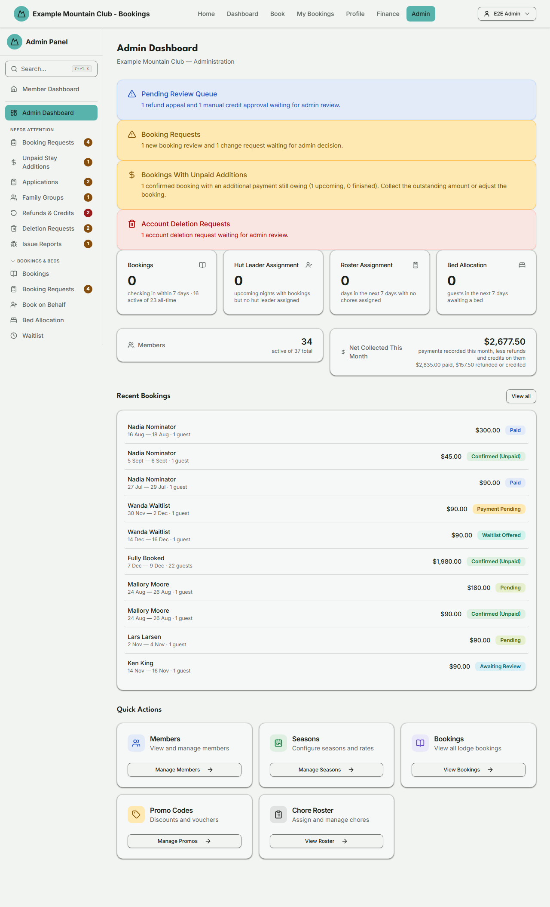

# Admin Dashboard

Audience: Operator

## What it is

The admin landing page: a set of **attention cards** for work that needs a
decision, headline **stat cards** for the club's numbers, a **Recent Bookings**
list, and **Quick Actions** shortcuts. Find it at **Admin → Admin Dashboard**
(`/admin/dashboard`).

Everything on the dashboard is a link into the area that owns the detail — the
dashboard never edits anything itself. The attention cards and the sidebar's
**Needs Attention** section are two views of one list of officer work queues
(see [`ARCHITECTURE.md`](../ARCHITECTURE.md) → Needs Attention / badges): for
the same admin they show the same queues with the same numbers. A queue appears
only while it has something pending and only to an admin who can open its
page with its module turned on, and it disappears once the queue is clear, so
it never implies work that isn't there.

## When you'd use it

- You've just logged in and want the one-screen view of what needs doing today.
- You want a quick count of active members, upcoming check-ins, or the money
  collected this month net of refunds, without opening the detailed reports.
- You want to jump to a pending queue (refund appeals, booking reviews, deletion
  requests) straight from the alert that surfaced it.

## Step-by-step

### Read the dashboard

1. Go to **Admin → Admin Dashboard**.

   

2. Scan the **attention cards** at the top. Each is a shortcut to the queue that
   raised it — click through to act on it.
3. Use the **stat cards** for the headline numbers, or the **Quick Actions**
   tiles to jump to Members, Seasons, Bookings, Promo Codes, or the Chore
   Roster.

### Find any page fast (command palette)

The admin panel has around ninety pages, and the sidebar links only some of
them, so you don't have to remember where a feature lives.

- Press **Ctrl + K** (Windows/Linux) or **⌘ + K** (Mac) from any admin page, or
  click the **Search…** button at the top of the sidebar.
- Start typing a page name — or a related word, such as "accounting" for Xero
  Sync or "permissions" for Access Roles — then use the **arrow keys** to move,
  **Enter** to open the highlighted page, and **Escape** to close.
- It lists **every** admin page you can open, grouped by area (Bookings,
  Finance, Lodge and so on), including pages the sidebar has no link for, such
  as Chores, Lockers, Seasons, Rooms & Beds, Email Messages and the setup
  wizards. The old sidebar section names, such as "Lodge Operations", still
  find their pages.
- A page that was merged into another keeps its old name as its own result,
  such as **Family Suggestions**, and opens the tab of the page that now holds
  it.
- It only ever lists pages **you** can open: the same permission check the page
  itself makes, so a page you aren't permitted to see, a module that is turned
  off, or a Full Admin page never appears for you.
- A lodge page opened from here starts on the club's first lodge; choose
  another lodge on the page.
- The two attention shortcuts — **Unpaid Finished Stays** and **Unpaid Stay
  Additions** — stay searchable as pre-filtered views even when nothing is
  currently owing, whereas the sidebar only surfaces them while their queue has
  something in it.

## Settings reference

The dashboard has no settings — it is read-only. The attention cards, in the
order both the dashboard and the sidebar show them. Each appears only while its
number is above zero and only to an admin who can open the page it links to:

| Card | Appears when | Opens |
| --- | --- | --- |
| Silent Xero Webhook | Xero has not delivered a webhook event for longer than expected | [Xero](xero.md) |
| Booking Requests | New booking reviews, change requests, new-booking policy exception requests or public booking requests are waiting; the number is all four together | [Booking Requests](booking-requests.md), on the first tab with something waiting |
| Unpaid Finished Stays | A stay ended but is still payment-pending | [Bookings](bookings.md) (pre-filtered) |
| Bookings With Unpaid Additions | A settled booking, finished or upcoming, has an upward change still uncollected | [Bookings](bookings.md) (pre-filtered) |
| Membership Applications | A membership application is waiting for approval | [Member Applications](member-applications.md) |
| Family Group Requests | A family group request is waiting for review | [Family Groups](family-groups.md) |
| Pending Review Queue | Refund appeals or manual credit approvals are waiting | [Refunds & Credits](refund-requests.md) |
| Manual Refund Tasks | The club owes a member a refund by hand and the task is still open | [Payments](payments.md) |
| Membership Lifecycle Review | A cancellation or archive request is waiting | [Cancellation Requests](membership-cancellations.md) |
| Account Deletion Requests | A member's self-service deletion or an admin-initiated member deletion is waiting; the number is both together | [Deletion Requests](deletion-requests.md) |
| Issue Reports | An issue report is not yet resolved | [Issue Reports](issue-reports.md) |
| Nights without a hut leader who counts | Upcoming nights have guests but no hut leader who is both assigned and staying that night — or, on a school group's night, none of a kind the lodge accepts for school bookings. An accepted school booking awaiting its invoice counts as guests; a quote the school has not accepted does not. Each entry gives the night and how many guests are on site. On a club with more than one active lodge this counts **lodge-nights** and names the lodge on every date, because each lodge needs its own leader — see [Hut Leaders](hut-leaders.md#what-counts-as-a-covered-night). Shown only when the Hut Leaders module is on | [Hut Leaders](hut-leaders.md) |
| Stuck States | Something is stuck in payments, bookings, Xero, email or lodge operations. The number is the Stuck States page's headline, refreshed at most once a minute. Shown only to admins with Support access | [Stuck States](stuck-states.md) |

Below the attention cards:

| Card | Appears when | Opens |
| --- | --- | --- |
| Handovers this week | On one of the next seven days a hut leader finishes at midday and another is on duty from midday. Each line names the day, who finishes and who takes over (and the lodge, on a club with more than one). Shown, and read, only for admins who can open Hut Leaders | [Hut Leaders](hut-leaders.md) |

If a queue's number could not be read, the dashboard says so above the cards
("Couldn't load counts for …", naming the queue) instead of hiding the card as
if the queue were empty. Reload the page to try again.

### How the sidebar keeps its numbers current

The sidebar loads its Needs Attention numbers when you open the admin area and
again whenever you move to another admin page, come back to the browser window
or tab, or finish a decision on a queue page (approving a request, closing a
task and so on). If they cannot be loaded it shows **Couldn't load counts**
with a **Retry** button, and keeps the last numbers it had; if only some
failed it shows **Couldn't load some counts** and the rest as normal.

Stat cards (each links to its detail area):

| Stat | What it counts |
| --- | --- |
| Bookings | Bookings checking in within the next 7 NZ days (the same list **Bookings** opens to), with the count of active bookings (pending, payment-pending, confirmed, paid and awaiting review) and all-time bookings (excludes deleted) beneath |
| Hut Leader Assignment | Upcoming nights (lodge-nights on a club with more than one active lodge) that have bookings but no hut leader |
| Roster Assignment | Days in the next 7 days with no chores assigned |
| Bed Allocation | Guests in the next 7 days still waiting for a bed |
| Members | Active members, with the total beneath |
| Net Collected This Month | Payments **recorded** this calendar month, **less the refunds and account credits on them**. A payment counts in the month its record was created, even if the money arrived later: an Internet Banking payment is recorded, as pending, when the booking is made, and counts in that month once it is paid. A payment still pending or failed adds no money, and neither does an unpaid bank-transfer payment that shows as partly refunded only because a Xero credit note was applied to its invoice. Money still owed back comes off straight away, on any booking: a refund owed by hand on an open hand-back task (a cancellation's, an edit's that lowered the price, or an approved refund request's), a card refund Stripe has not yet paid, and a late card charge waiting for the treasurer to refund or keep it. Cancelled bookings are **included**, but only for what the club kept of what was paid on them: money not refunded or credited back, less anything still owed back, less a bank transfer that arrived after the cancel and was credited to the member, plus account credit the cancellation kept. That kept credit counts even when the payment itself took no money, as on a booking paid wholly with account credit. A booking cancelled before anything was paid, in money or account credit, adds nothing. Deleted bookings are left out. All four Net Collected figures (this card, the Payments page's, Reports' and the Finance dashboard's Net Collected) use that same rule for which bookings count. When anything has been refunded or credited, is owed back or was kept from account credit, those amounts are shown beneath the headline beside the amount paid, in exact cents like the headline, so the arithmetic on the card adds up. Beneath that, **Refunds owed** and **Credits owed** say what the club still owes back, **as at today and across the club** (not this month's): every refund owed and not yet paid (by hand, by card while Stripe has not yet paid it, or a late card charge waiting for the treasurer), and every member's account credit not yet used. Each stays until it is paid, kept or the credit is spent, and each comes off Net Collected only for its own booking - except a group organiser's repayment task (#4042), which is in Refunds owed but comes off no booking's Net Collected, because the joiners' Net Collected already treats that money as refunded. On a narrow screen the two figures stack under the card's title |

## Troubleshooting

| Symptom | Likely cause | Fix |
| --- | --- | --- |
| An attention card vanished | Its queue is now empty | Nothing to do — the card only shows while work is pending |
| A queue shows in the sidebar but not on the dashboard, or the reverse | They read the same counts, so one of them is out of date | Reload the dashboard; the sidebar refreshes when you change page or return to the tab |
| "Couldn't load counts" | A count could not be read from the database | Click **Retry** in the sidebar, or reload the dashboard. If it persists, tell whoever runs the club's site |
| A card another admin sees is missing for you | Cards follow the same permission and module rules as the pages they open | Ask a full admin to check your access role and [Modules](modules.md) |
| Net Collected looks wrong for the month | It is **net of refunds and credits**, and it groups payments by the month their record was **created**, not the month the money arrived. A bank transfer paid this month on a booking made last month counts in last month; a refund made this month on last month's payment reduces last month, not this one. A cancelled booking counts only what the club kept of what was paid, account credit included; one never paid counts nothing | Use [Reports](reports.md) for a chosen date range, or [Payments](payments.md) for a filtered list |
| A quick-action tile is missing | The related module is off (e.g. Chore Roster needs the `chores` module) | Enable it in [Modules](modules.md) |

## Related links

- Back to the [documentation hub](../README.md).
- Sibling queues: [Booking Requests](booking-requests.md),
  [Refunds & Credits](refund-requests.md), [Payments](payments.md),
  [Issue Reports](issue-reports.md), [Stuck States](stuck-states.md),
  [Deletion Requests](deletion-requests.md),
  [Cancellation Requests](membership-cancellations.md).
- Reference: the Needs Attention / badges model in
  [`ARCHITECTURE.md`](../ARCHITECTURE.md).
