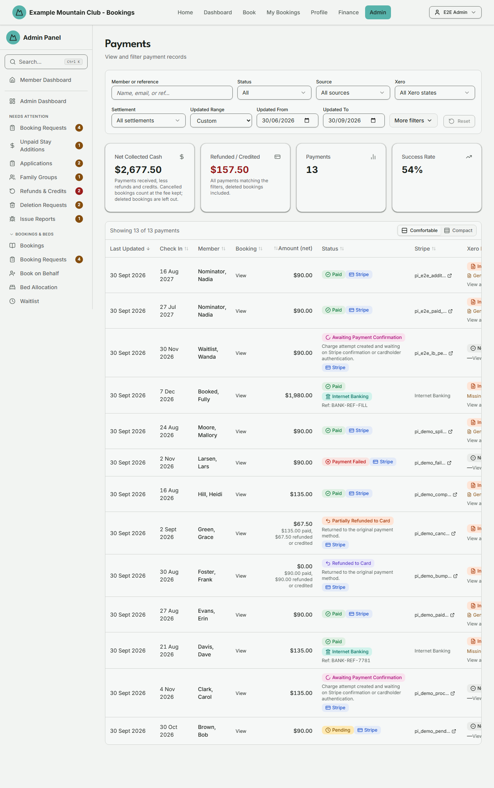

# Payments

Audience: Operator

## What it is

A filterable, sortable ledger of every booking payment — Stripe card payments
and Internet Banking bank transfers — showing the amount, status, Stripe link,
Xero invoice state, and any cancellation-settlement breakdown, with an inline
action to generate a missing Xero invoice. Find it at **Admin → Finance →
Payments** (`/admin/payments`).

Payments is a **finance** permission area: you need finance view access to open
it, and finance **edit** access to generate invoices. Amounts are stored as
integer cents and shown as dollars.

## When you'd use it

- A member asks whether their payment went through, or for a receipt/invoice.
- You are reconciling Stripe or Internet Banking payments against bookings.
- A payment is refunded or credited and you want to see the settlement
  breakdown.
- A successful payment has no Xero invoice yet and you want to generate one.

## Step-by-step

### Open and read the ledger

1. Go to **Admin → Finance → Payments**. The stat cards summarise the current
   filter (Net Collected, Refunded / Credited, Payments count, Success
   Rate),
   and the table lists each payment.

   

2. Each row shows the last-updated date, check-in, member, a **View** link to
   the booking, the amount (net of refunds and credits, with "paid, refunded or
   credited" beneath it when anything has gone back), the status chip (with a
   Stripe or Internet Banking sub-chip), the Stripe payment link, and the Xero
   invoice state.

### Find a payment

1. Type a name, email, or payment reference into **Member or reference**.
2. Narrow with **Status**, **Source** (Stripe / Internet Banking), **Xero**
   state, **Settlement** kind, and the **Updated** date range. Open **More
   filters** for exact/min/max amount and a check-in date range. Click **Reset**
   to restore all filters, sort, and page. The default **Updated** range is the
   rolling NZ date three months before today through today, not all history.

### Generate a missing Xero invoice

1. Find a **Paid** (succeeded) Stripe payment whose Xero column shows **Invoice
   missing**.
2. Click **Generate Invoice**. The chip changes to **Queued** while Xero
   processes it. This action needs finance edit access; a view-only finance role
   sees it disabled.

### Record a payment made in cash or by an off-Xero bank transfer

Some money never reaches the app: a member pays cash at the lodge, or makes a
bank transfer for a club that does not use Xero invoicing.

1. Open the booking (Admin → Bookings → the booking, or **View** from this
   page) and find **Cash / off-Xero payment** in the **Admin tools** card.
2. Click **Record manual payment**. The dialog shows the exact amount owing
   (after any account credit already applied), takes an optional note for the
   club's records, and asks whether the member should be emailed the usual
   booking confirmation. The payment is recorded either way, and your choice is
   written to the audit log. If the booking's **No emails** switch is on, the
   dialog says so instead of offering the choice.
3. The booking becomes **Paid** and its beds are claimed, exactly as a card
   payment would. Nothing is sent to Xero: no invoice is created, and none is
   emailed.

**When the booking still has an extra owing from a later change.** If the
booking was priced up after it was first made — someone added a guest, say — the
increase is recorded separately as an "additional payment" that the member is
normally asked to pay by card. If that extra has never been collected, the
dialog says so before you record anything. It shows the booking amount before
the change, the extra, and what the booking owes in total — the extra is *part
of* that total, not on top of it — and asks one question: **does the money you
have received cover that addition as well?** You must answer before the
recording buttons work; neither answer is a default, because guessing either way
is a guess about money. The dialog deliberately does not name a total until you
have answered, because your answer changes it:

- **Yes** records the full amount owing, including the addition, and marks the
  addition settled. Nothing will chase the member for it again: the "$X due"
  chip disappears from the bookings list, the reminder emails stop, and the
  booking's history gains an entry saying the payment you recorded also covered
  the extra.
- **No** records **only the amount owed before the change**. The booking is
  still marked paid, but the club's books say it received that smaller amount
  and is still owed the addition — so the two figures add up, and the member is
  rightly still asked for the rest. If the whole amount owing *is* the addition,
  there is nothing left to record and the action is refused.

**How the member pays an addition you said the cash did not cover.** Recording a
cash payment normally cancels any card payment the member still had open for the
booking, so they cannot accidentally pay twice for money you already hold. The
one exception is the card payment for the addition itself: if you answer **No**,
that one is deliberately left open, because the club is still asking for it and
that is the member's own way to send it. They can pay it from their booking page
exactly as they could before, and once they do, the booking's books balance on
their own — nothing further for you to record.

Some additions have no card payment set up (an older booking, or one where the
card step never got as far as being created). The confirmation on screen tells
you which situation you are in: either "they can pay it themselves from their
booking page", or "someone will need to contact them to collect it". If it is
the second, contact them — there is no other door. If you would rather undo the
whole thing and start again, **Reverse manual payment** puts the booking and the
addition back exactly as they were.

Either way the confirmation on screen repeats which it was and names the figure
that was recorded. The member's confirmation email says the same thing: instead
of "Total Paid" it shows the booking total, what has been paid, and what is
still owing, and it tells them how to pay the rest. If the extra changes while
your screen is open, or one appears that was not on your screen when you opened
the dialog, the recording is refused rather than guessed and you are asked to
refresh.

**If the extra is bigger than the whole amount owing.** This can happen when a
change fee was charged: the fee is added to the recorded addition but not to the
booking's price, so the addition is no longer a slice of what the booking owes.
Neither answer can be recorded honestly, so the action is refused. Ask the member
to pay the addition from their booking page, or correct the booking's price, and
then record the payment.

**If the booking's payment has already taken money.** A booking whose card
payment succeeded but whose status never caught up cannot also be recorded as a
cash payment — the card money is already in the ledger and recording cash over
the top of it would misstate the books. The button is not offered, and the
reason says so. Check the payment (and whether a refund is owed) before
recording anything.

**When the member had asked to use their account credit.** If they ticked "use
my credit" and saved the booking as a draft, and that credit was never applied,
the dialog warns you before you record anything: it names the amount they asked
to put towards the stay and says plainly that taking cash cannot use it. That is
not a reason to refuse the money — if they have handed you the full amount, take
it. Recording the cash clears the saved choice rather than spending their
credit, because the money you collected settled the booking in full, so their
credit balance is untouched.

Afterwards, the confirmation you see on screen repeats the amount and confirms
the credit is still on their account, the booking's history tells the member the
same thing, and the admins are alerted. That alert quotes their **live** credit
balance, not the amount they elected — the two often differ, because the choice
may have been made months and several bookings ago — and it states the most that
could sensibly be refunded against this booking, which is never more than the
account actually holds. If the balance has been spent since, it says there is
nothing to refund.

Reversing the payment (below) puts the saved choice back on the booking, so the
member can use their credit when they pay it properly. Your screen confirms that
too.

Needs finance **edit** access. It is refused — with the reason shown — when the
booking already has a Xero invoice (or one queued), when it was settled as part
of a group booking, when there is nothing owing, when the booking no longer fits
the lodge, or when the amount changed while your screen was open. Recording it
against the Xero invoice in Xero is the right move in the first case.

**Reversing it.** If you recorded it against the wrong booking, use **Reverse
manual payment** on the same card. The booking goes back to unpaid — it is *not*
cancelled — and the member is not emailed. Any account-credit choice the
original recording cleared is put back on the booking, so the member can spend
that credit when the booking is paid for real. An extra you confirmed the cash
covered goes back to owing as well, so the booking is not left unpaid while its
later addition still reads as collected. What is un-recorded is exactly what was
recorded — so if you recorded only the amount owed before a change, only that
amount is undone. A booking restored to
awaiting-payment stops holding its beds, so other bookings can take them, and
recording the payment again later can be refused if the lodge has filled in the
meantime. This is only possible while nothing has happened since that a
reversal could not undo: no refund, no card payment, no open refund task, and
no Xero invoice.

### Pay back a refund for a cash booking

When a booking that was paid in cash is cancelled, there is no card charge to
reverse, so the system raises a task instead of pretending money moved. It
appears at the top of this page in the **Money to settle** card, and the
member is told the club will arrange their refund.

1. Pay the member back however the club normally does.
2. Click **Mark paid back** on the task. Only do this once the money has
   actually gone — that click is what records the refund in the payment ledger
   and on the booking's history.
3. **For now these tasks cannot be dismissed** (#4516, owner decision 14 Nov
   2026). The card shows "This refund can't be dismissed yet" where the
   **Dismiss** button was, and the app refuses a dismissal. If the member
   declined the refund, or it was settled another way, leave the task open:
   a later update adds a dismissal that asks why and records each answer
   exactly. This applies to every hand-back the club pays by bank transfer or
   in cash: a cash cancellation's, a booking change's, an approved appeal's,
   and the bank-transfer part of a card refund shortfall. A card refund
   shortfall's part to check can still be dismissed, once you have confirmed
   the card refund reached the member (owner decision, 15 Nov 2026; see below).
   So can the hand-back a cancellation or a booking change raises when the
   cardholder is disputing the card payment (owner decisions, 15 and 18 Nov
   2026), once Stripe records the dispute as lost for at least the refund due:
   the cardholder already has the money back through their bank, so dismiss it
   with a note. Lost money is counted once across all the refunds on that card
   payment, oldest refund first: a $100 loss on a payment with a $100 refund
   from a booking change and a later $200 refund from its cancellation lets you
   dismiss the $100 one and leaves the $200 one owed in full, never both. A
   refund the loss does not reach says so, and is paid as usual. While the dispute is open, if the club won it, or
   if it was lost for less than the refund, the app refuses Dismiss and says
   why: the club may still owe that refund. For a dispute lost for part of the
   refund, use **Reduce by lost dispute** instead (owner decision, 15 Nov 2026):
   the confirmation shows what the refund was, what it is reduced by and what
   is still owed, and the task stays open for the rest, which you then pay and
   mark paid back as usual. Each further dispute lost on the same payment can
   reduce it again; once the lost disputes cover all of it, dismiss it. The app
   refuses **Mark paid back** at the full amount while a lost dispute has not
   yet reduced the refund (it would pay the lost part twice), including while
   another dispute on the same payment is still open (wait for that one first),
   and refuses it altogether once the lost disputes cover all of it. If you paid
   the member by bank while the dispute was open and it was then lost, they have
   had that money twice and the app cannot record your payment: take it to the
   treasurer. In rare cases Stripe turns a
   lost dispute into a "late win" and returns the money to the club (#5197).
   The app then puts every task dismissed for that loss back on the queue,
   with the member's refund owed again, and sends Finance a "Lost card payment
   dispute now won" alert naming each one: pay them as usual. If another lost
   dispute still covers part of a reopened task, the alert says so: reduce it
   again before paying. A task the app could not reopen (the booking was busy, for
   example) is named with the reason: reopen it here (the recently dismissed
   list offers it for 30 days; after that, take it to the treasurer). A
   booking change's refund dismissed before its booking was cancelled is named
   as counted by the cancellation, whose own refund already includes it. A
   reduction made for the loss stays as it is: the alert names the amount now
   owed again, so pay the member that by bank transfer with the rest and take
   it to the treasurer to record. A booking change's refund dismissed for a
   lost dispute after its booking was cancelled can be reopened like any other,
   if it was dismissed after this change. An earlier dismissal did not record
   whether the booking was already cancelled, so the alert names it as not
   reopened, to check by hand: the app cannot tell whether the cancellation's
   refund included it, and reopening it here is refused for the same reason.
   Like the lost-dispute allocation itself, a
   late win counts a refund task dismissed for another reason by older code as
   dismissed for the loss, so it may reopen it: take such a task to the
   treasurer.
   A task dismissed before these dismissal rules (#4516) can still be
   reopened, except the older booking change's refund above, which is
   refused as above.

**The same task for a booking change (#3827).** When a member or an officer
changes a booking that was paid by internet banking or in cash, and the change
lowers the price (fewer nights, a guest removed, a promo code re-applied when a
guest accepts their place), the money back has no card to go to either. The
change raises one of these tasks for the refund amount, and the member's email
says the club **will** refund them by bank transfer. Pay it and mark it paid
back exactly as above. The Xero credit note for the change is raised with the
change itself, so marking the task paid back sends nothing further to Xero: in
Xero, record the refund against that credit note. Each change raises at most
one task. A card-paid booking is refunded to the card automatically and raises
none.

One kind of card payment is treated like a bank payment here (#5212): a booking
recorded as paid by card that Stripe holds no record of, so there is nothing
for a card refund to be made against. A change that lowers its price raises the
same task and sends the same email, and no card refund is promised or tried.
The edit screen's price summary offers that refund as **Refund by bank
transfer**, as it does for an Internet Banking booking, never as a refund to
the original card (#5303). So does the **Return method** choice when moving a
linked booking, and the offer's own sentence about where the money goes; where
that one choice covers a card booking and a bank-transfer booking, it names
both.
For now, **Mark paid back** is refused on most of these tasks, because the
payment has no card charge on record for the refund to be recorded against.

**Warning: an open task of this kind may already have been paid.** Because it
cannot be closed, it still looks unpaid after someone has paid the member, and
a second officer following "pay it and mark it paid back" above would pay the
member twice. Before paying one, check Xero and the club's bank account for a
refund already sent for that booking. After paying, record the refund in Xero
against the change's credit note, tell the other finance officers (the
booking, the amount and the date paid) and your club administrator, and leave
the task open until #5290 lets you close it.

While such a task is open, its amount counts as already promised back. A later
change or a cancellation of the same booking refunds only what is left of the
money paid, never that amount a second time, and a refund appeal can ask for
and be approved only up to what is left. For the same reason a dismissed one
cannot be put back on the queue once that money has been refunded or promised
back another way. Once the booking is cancelled, the cancellation has already
counted an open task as money going back and a dismissed one as never owed, so
from then on an open task can only be marked paid back (Dismiss is refused) and
a dismissed one cannot be reopened. If the club decides not to pay an open one
after all, that changes the cancellation's own figures: take it to the
treasurer rather than dismissing it.

**The same task for an approved refund appeal (#3827).** Approving a refund
appeal on a booking paid by internet banking raises one of these tasks for the
approved amount (on a booking paid partly by card, for the part the card
refund cannot carry), and the member's email says the club **will** refund
them by bank transfer. Pay it and mark it paid back exactly as above. Marking
it paid back queues that appeal's own Xero refund credit note for the amount
you paid back; each appeal gets its own note, beside the payment's one refund
note for its cancellation. A booking with no Xero invoice yet gets no note
then; once its invoice exists, the booking repair tool reports it (#4231), and
its report stays even after a credit is raised by hand, because the app cannot
record one. Where the payment has no cancellation credit note, the officer
checks this booking's invoice in Xero for a credit already raised for that
appeal: if there is one, nothing more is needed; if not, the officer confirms
the tool's offer of the appeal's note by its action key - the tool never raises
it alone. Where the payment may have a cancellation credit note, it may
already include the appeal's money, so the officer works in two steps. First,
always compare that note's lines on the booking's invoice in Xero with the
cancellation's own refund, and edit it in place if the appeal's money is in it
(never void it). A note Xero voided, or a create row withdrawn in Xero
Operations, holds nothing; for one still queued or failed there, wait for it or
check its amount before going on. Second, raise the appeal's own credit note by
hand only if no credit for the appeal exists yet.

While the task is open its amount counts as already promised, so a second
appeal can only be approved for what is left. An appeal's limit also leaves
out every other task still open on the payment, a cancellation's own
included, any account credit already given for a bank transfer that
arrived after the cancellation, and any card refund on the payment not yet
made (being retried, or stopped and listed on
[Stuck States](stuck-states.md#close-a-card-refund-stripe-gave-up-on)). Because an appeal is only ever
made after the booking is cancelled, the cancellation never counted this task.
Like every bank or cash hand-back, it cannot be dismissed for now (see step 3
above).

**On a joiner's booking the group organiser paid for by internet banking
(#3949).** Both tasks above can be raised on such a booking: a joiner's change
that lowers the price, or an approved appeal on their place. A change that
lowers the price offers no choice of card or account credit: the refund, at the
card refund tier, always goes back to the organiser this way, and the joiner is
never given account credit for it (a guest whose consent lapses is removed the
same way, and a member's single card-or-credit choice for a linked move of two
bookings does not apply to such a booking: the offer says how much goes back to
the organiser instead, and while the organiser is cancelling the group the
offer lets the member move only their own booking). The money came
from the organiser's one group payment, so it goes back to the **organiser**,
not the joiner: the task's reason says "to the group organiser by bank
transfer", the paid-back dialog says the money goes back to the group
organiser, and the joiner's email says the club will refund the group organiser
directly. Send it to the organiser and mark it paid back as above; that records
the refund against the joiner's share of the group payment, and the group's own
settlement is left as it was. Until #4292 ships automatic notes, the app raises
no Xero credit note for these (the joiner's booking has no invoice of its own;
the money was taken on the group's combined invoice), so once you mark one paid
back the finance contacts get a **Xero Sync Error** email naming the amount,
the organiser and the invoice: in Xero, raise a credit note for that amount to
the organiser against the group's invoice and record the bank refund against it.
A place that has an extra invoice for a later price increase (#4299) is the
exception: there the app raises the notes itself once you mark the task paid
back (one against the group's invoice for the share, one against the extra
invoice for the extra's part), so do not raise a note by hand for it.
When the joiner cancels their own place with a refund due, the cancel raises
one of these tasks too, for the policy's card-tier refund, to the organiser
(never account credit for the joiner), and admins get the **Manual refund
needed** email naming the organiser the refund goes to, and the task's reason
names them too (a customised message
shows that through `{{handBackNote}}`, as below). A price review on
such a booking that the club settles as money owed back goes to the organiser
the same way. One that finds the joiner owes the club is refused: the club
cannot ask for that money from here, so agree it with the organiser, collect it
another way and dismiss the review with a note. Once the joiner's booking is cancelled, by the joiner or by the
organiser's cancellation of the group, such a review is refused and has to be
settled by hand and dismissed. While the organiser's cancellation of the group
is still part-way through, marking one of these paid back is refused: mark it
once the cancellation has finished. Any change to the booking's price or that
charges a change fee (adding a guest included), and an approved appeal that
would raise a new one, is refused too - the member's edit screen says so before
they save; once the booking shows as cancelled, decide whether anything more is
owed. The rules above are unchanged: once the organiser has
cancelled the group, a change's task can only be marked paid back. For now an
appeal's cannot be dismissed either (see step 3 above). Tasks raised before this change,
which could not be marked paid back at all, now can.

**The same task for a group paid by internet banking (#4042).** When the
organiser of a group they paid for with one internet banking settlement
cancels it, each joiner's refund is recorded in the app's ledger straight
away, but nobody has sent any money: the club repays the organiser by bank
transfer. The cancel raises one of these tasks on the organiser's booking, and
its total is every joiner refund the ledger shows for the group, kept up to
date as each joiner's place is cancelled; its reason lists the shares (a very
large group lists the first ones and counts the rest: see each joiner's
booking). Admins get the **Manual refund needed** email once, after the cancel
has worked through the joiners, with the amount owed when it was sent (pay the
total the task shows). It goes at least once; a crash between sending and
recording can repeat it. If it could not go out - the app stopped first, or it
reached nobody - the background job that tidies group settlements sends it on
a later run, once the cancel has finished; after three attempts that reach
nobody it stops, and the task on this page is the record. Mark the task paid
back once the money has gone; that records only that the money went, because
the refunds are already in the ledger, and sends nothing to Xero. If the total
changed while you had the page open, you are told the new total: repay the
difference, then mark it paid back. It cannot be dismissed: the refunds are
already recorded as made, so if the club decides not to repay the organiser,
take it to the treasurer to correct the cancelled bookings. Each group raises
at most one task, however often the cancel is re-run; a joiner's share
recorded after the task was marked paid back gets a task of its own for what
the first did not cover. If the group's combined Xero invoice was paid, the
alert that it could not be voided points to this task: pay the organiser what
the task shows, not the invoice's paid total, then raise a credit note on the
invoice in Xero for the amount you repaid and record the refund against that
credit note.

A club that has customised the **Manual refund needed** message keeps its own
wording for this email too. Add `{{handBackNote}}` to the body (and keep
`{{handBackLabel}}` in the subject, which is now required) so the group
wording appears; until then the email's reason line still says it is a
group repayment. `{{handBackHeading}}`, `{{handBackRecipientLabel}}` and
`{{handBackAmountLabel}}` fill in the heading and the row labels for whichever
case it is, the card refund shortfall below included. The editor's preview
shows the cash wording.

**The same task for a card refund that falls short (#4097).** A card
cancellation refunds to the card only what the payment's card charges can
still give back. When that is less than the refund the cancellation policy
gives, usually because the payment's records disagree, the cancel records the
rest as up to two of these tasks, and admins are emailed once ("card refund
short on a cancelled booking"). The cancel dialog says so before anyone
confirms (#4119): its refund option and summary show only the card's part as
going to the card, then the bank-transfer part and the part "To be confirmed
by the club", worked out the same way the cancel works them out.

- **The part to refund by bank transfer** is what the payment's other
  (non-card) charges still hold. The member is told the club will refund it by
  bank transfer: mark it paid back first, then pay it by bank transfer straight
  after the app accepts - it refuses while the card refund is still moving, or
  where the payment's records no longer hold the money. Accepted, it records
  the refund on the payment and the booking ledger and queues one Xero refund
  credit note for exactly that amount, worded as a bank transfer, beside the
  card refund's own note; nothing needs recording in Xero by hand. A booking
  with no Xero invoice to credit gets no note.
- **The part to check before paying** is anything beyond that: the payment's
  records show it already refunded, or nothing holds it. The member is told
  only that the club will be in touch. Check Stripe and the bank, then contact
  the member with what you found. Dismiss it, with a note saying how, only
  once you have confirmed the card refund reached them. If it really is owed, mark it paid back first - after the
  bank-transfer part, which the app requires, since both are settled on the
  same money. The app first checks it can record it: pay it by bank transfer
  straight after it accepts. Where the payment's records show nothing left to
  refund, the app refuses and says what to do instead: dismiss it once you have
  confirmed the card refund reached the member, and if the member really is
  owed, take it to the treasurer before paying anything, since the app cannot
  record that payment. (The bank-transfer part's refusal says to leave it open,
  because it cannot be dismissed yet.)

**Neither part can be marked paid back until the card refund itself has gone
through.** While Stripe is still making it, the app says to mark the part once
it settles. If the card refund failed and is waiting to retry, wait for the
retry. If its retries have run out, close it as **Paid another way** on
[Stuck States](stuck-states.md#close-a-card-refund-stripe-gave-up-on) once the
member has had that money back, then mark the part.

**The same part to check when the dates fill up during a card payment
(#4154).** If a member's card payment completes after the last beds went, the
booking is cancelled and the card refunded automatically - but only for what
the payment's records show can go back to the card. When that is less than
the charge, or nothing, the rest appears here as one part to check, and the
officers are emailed once. The member's booking page says the club will be in
touch about it; no email goes to the member about it. Check Stripe and the
bank first, because the records may be wrong and the money may already have
gone back. Once you have confirmed the card refund reached the member, dismiss
it with a note saying how, and the member's page then says the club checked it
and closed it. If it really is owed, use
**Mark paid back** first, once the card refund has gone through, and pay
straight after the app accepts. The app first checks it can record it, only on
that card charge:

- It asks Stripe what the charge has refunded. If Stripe shows more than the
  app has recorded (a refund made in the Stripe dashboard that has not reached
  the app yet), or Stripe cannot be reached, it refuses for now: try again in a
  few minutes, and do not pay until it accepts. If it keeps refusing, check the
  charge in Stripe; if the member is owed, take it to the treasurer before
  paying anything: the app cannot record it.
- Where the charge's records read more refunded than its card refunds on
  record, it corrects them itself first, and logs the correction in the audit
  log, but only for a charge made since the app has kept a record of each card
  refund, on a booking with no account credit given back and no other refund
  task.

If it accepts, pay the member by bank transfer straight away; it records the
refund, queues its Xero refund credit note, and the member's page says the
whole payment was refunded. If the nightly Xero check already raised a card
refund note for that money, the app counts it and its own note covers only the
rest. If the app cannot tell that note apart from one for another charge on the
payment, it refuses and says so, and its message then never asks for a note by
hand. A booking with no Xero invoice to credit gets no
note - usual here, since a payment that lost the race is rarely invoiced. If it
refuses, it says why: if the member is owed, take it to the treasurer before
paying anything, because the app cannot record that payment. Raise the refund
credit note in Xero by hand only where it says to (the booking has an invoice
and no note covers it yet).

If the card refund itself stopped retrying, close it as **Paid another way**
on Stuck States once the member has had that money back, but do not then mark
this part: that close is another refund task, so the app cannot record this
one. Take it to the treasurer, as the app says, or dismiss it once you have
confirmed a card refund already reached the member for it.

One gap the app cannot close: a refund made in the Stripe dashboard in the
moments between **Mark paid back** and your bank transfer. When that refund
reaches the app, the charge already reads fully refunded, so officers are
emailed that a card refund took the charge past what was charged. Where the
member has already had money back another way on that payment - any hand-back
marked paid back, a card refund closed as Paid another way, or account credit
given back - the email says they may have been paid twice: check Stripe, the
bank and their account credit, and recover any overpayment. Otherwise it says
the charge's records drifted: check the charge in Stripe against the booking's
payment records.

The card holds several kinds of row and says which is which: a cash hand-back
(above), a part payment settled in Xero (next), a booking change to price
("Decide a booking change the system would not price"), an amount the club may
not have asked for ("Check an amount the club may not have asked for"), a
late card payment held for approval, a group organiser's repayment, a card refund that fell short (above) and a bank refund to re-confirm
(next). Each kind's explaining paragraph appears
only when a row of that kind is waiting, and none of them speaks for the others.

### Answer a bank refund whose Xero credit note was voided

When you mark a bank refund paid back, the app records it and Xero gets a
credit note that mirrors it. If that credit note is later **voided in Xero**,
the refund is no longer recorded anywhere the books agree on. So each night
(#4162) the app takes the refund back out of the payment's records - its
refunded total, its refund history and the booking's ledger - and puts it back
in **Money to settle** as owed, with one question:

> Booking B-123: $200.00 to Sam Lee. Its Xero credit note CN-0456 was found
> voided on 14 Oct 2026, so it's back on this list. Has the $200.00 gone to the
> member?

("Found voided" is the day the app learned of the void, not Xero's own date.)

Nothing is sent to the member and nothing is raised in Xero until you answer:

- **Yes, it has gone → Yes, raise a fresh credit note.** The refund is recorded
  as paid back again and **one** new credit note is queued for Xero, dated
  today. Nothing is copied from the voided note. If the payment has no Xero
  invoice for a note to credit, the app refuses and says so: use the next
  answer with a note you made in Xero.
- **Yes, it has gone → Yes, I already recorded it in Xero myself.** Type the
  number of the credit note you made in Xero (for example `CN-0123`). The app
  reads it from Xero and checks that it is a sales credit note, **approved or
  paid**, for exactly this amount, for the **same contact** as the booking's
  invoice, and not allocated to another invoice. It also refuses a note the app
  already records for another refund, including one whose Xero operation is
  unfinished or that you marked resolved (#4321), including a note you made by
  hand for a failed refund credit note and gave when you resolved it (#4421).
  A failed operation resolved before that change records no note number, so
  never give a note that already records another refund. If not, it tells you why and
  nothing changes. If
  Xero is busy, try again in a minute; if Xero's daily limit has been
  reached, try again tomorrow; if the booking has no Xero invoice and its
  owner no Xero contact, there is nothing to check the note against, and the
  app says so. If it is, the
  refund is recorded as paid back again against that note, and the app keeps
  track of it: it reads the note once more straight afterwards, and if that
  note is ever voided too, the refund comes back here again.
- **Not yet.** Cancel the dialog and leave it on the list until the money goes.
- **No, the club keeps it.** The refund stays out of the payment's records and
  no note is raised. A reason is required.

If the voided note was only a **duplicate** - Xero still has live notes for
every bank refund on that payment - nothing changes and nothing is asked.

**A card refund's voided note is different** (#4250). Stripe shows the money
went out, so each night the app raises a fresh credit note for it, even if the
voided note was one you had marked *Resolved in Xero*. Don't make a replacement
note by hand as well: Xero would then have two.

A voided note the app cannot match to a single refund (an older note that
covered several refunds at once, or one whose amount it cannot read) appears on
**Stuck States** under **Voided bank refund notes to answer**
([guide](stuck-states.md#pick-the-refund-a-voided-bank-refund-note-recorded)).
Press **Pick the refund**, choose which of the payment's bank refunds the note
recorded, and the app takes that refund back out of the records exactly as it
does for a matched note - it then appears here with the same question. A note
that recorded several refunds takes one pick per refund, each with its own
question here, until the picks add up to its amount.

This only happens once your administrator has switched it on (see
[`UPGRADING.md`](../UPGRADING.md)); until then the app only reports what it
would do, and the Stuck States list is read-only.

### Settle a part payment an officer cancelled as unpaid

When an officer cancels an internet banking booking while Xero shows a payment
against its invoice that the club cannot hold as account credit — the booking
belongs to an organisation, or Xero could not give the exact amount — the
booking is cancelled as unpaid and a row with no amount appears in **Money to
settle**, with its own paragraph explaining it
([Internet Banking](internet-banking.md)).

1. Settle the payment in Xero: refund it, or apply it where the club decides.
2. Clear whatever the invoice still owes in Xero.
3. Click **Close this item** and say what you did. A note is required. There is
   no **Mark paid back** on this row, because nothing in the app moves money for
   it. Closing it also stops the Xero repair tool listing the booking for review.

If Xero later reports the invoice paid — because you cleared the rest, or more
money arrived — the app does not credit or hand back anything for it by itself,
because it cannot tell which of that money this row already covers. Instead the
row says so: "Xero reported this invoice paid on …, with … of cash recorded
against it". A row you had closed comes back onto the card with that line. Check
the invoice in Xero, settle anything beyond the part payment, then close the row
again. The app also tries to email the club, but the line on the row is the
record, so do not wait for the email.

### Decide a booking change the system would not price

**There is nothing left to decide here: officer reviews were retired.** Every
booking change is now priced automatically when it is saved — see
[Bookings — How a booking change is priced](bookings.md#how-a-booking-change-is-priced).
Before that, a change the records could not price was saved with its money held
as a review on this card, for an officer to settle by hand. The club's clean-up
settled or closed every review that was still open, and the screens that priced
them went with them: the settle box, its per-night price boxes, the
**Record the adjustment** and **No adjustment** buttons, and the **Nights whose
sold price the records cannot tell us** tool on a booking's **Admin tools** card.

- **No review appears on this card any more**, and none can be put back on it.
- **A review that was settled or closed is still on record.** Its amount, who
  closed it, when and their note are in the booking's history and its audit log,
  and any refund, credit or charge it made is in the booking's payments and in
  Xero as before.
- **If a page you had open still shows a review**, it is from before the change:
  it has no buttons, and closing it is refused with a sentence saying the review
  was retired. Reload the page.

A booking with a review waiting also shows a **Money waiting for review** warning
on its own page, under **Admin tools**, with a link back to this page.

**What an open review does and does not block.** A review raised against a
captured payment blocks that payment's manual settlement from being reversed —
the block is scoped to the payment the task names. A review with no payment
behind it, which is the ordinary shape when the adjustment would be an account
credit, blocks nothing: there is no settlement for it to sit in front of. So do
not treat an open review as a guarantee that the booking's money is frozen.
Check the booking's own payment history before reversing anything on a booking
that has a review waiting.

### Check an amount the club may not have asked for

*Coming in the release after this one. The item type is registered now so that
release turns a writer on rather than rebuilding this screen; until then a
withheld share is recorded in the booking's audit history exactly as it has
been, naming the change and the total in plain words.*

When a booking change is settled as money the member owes, the club raises a
Xero invoice for it. Once in a while the settlement lands in the seconds while
that invoice is already being sent — and an invoice in that state cannot be
changed. It has not necessarily *gone*: a job that has been picked up can come
back and go out later at the full amount.

So the club does not invoice the extra automatically, and that is deliberate
rather than an oversight. If it did, and the first invoice then went out at the
full figure after all, the member would be billed twice for the same change.
Instead the amount becomes a row in the **Money to settle** card for
somebody to check.

1. Open the booking's invoices in Xero.
2. Compare them against the amount on the row. If they already include it,
   nothing is owed.
3. If they fall short, raise a supplementary invoice **for that amount only** —
   never for the change's full total, which the member has already been asked
   for. Billing the total is the mistake this row exists to prevent.
4. Click **Close this item** and say what Xero showed and what you billed. A
   note is required, and it is the only record of how the amount was settled.

**A row that says "Amount not known" is not waiting to be priced.** Most of
these rows name the exact amount. One kind cannot: when the row is raised by the
payment-recovery pass, that pass knows the change's combined total but not which
part of it the invoice that went out already carried. There is no figure for the
screen to show and nothing here can work one out — compare the booking against
Xero and bill the difference, if any, by hand.

**Closing it moves no money, and there is no control that does.** Unlike every
other row in this card, this one has no "mark paid back" or "record the
adjustment" button, because there is nothing here for the club to pay or to
take. The only action is to close it, and the system refuses a settlement
against one of these rows however it is asked.

### A refund that happened without you — "Refunded automatically"

Sometimes a member pays at the same moment the booking is being cancelled — or
deleted. That happens both for a booking's own payment and for a payment for a
change to it. The payment goes through against a booking that is on its way out, and
Stripe hands the money straight back to the member on its own. Nobody decided that,
and there is nothing for you to pay back. (That is the default. A club can choose to
have a treasurer approve these refunds instead — see the next section.)

Those refunds appear on this page in a second card, **Refunded automatically —
nothing to pay back**, above the filters. It lists the member, the amount, the day
the money went back and the stay, and it covers the last 30 days.

**The card is split into two groups, and the top one is the one to read.**

- **The booking was deleted.** Worth a look. If deleting the booking was the mistake
  rather than the payment, the refund has already gone out — so the booking has to be
  made again and the member charged again. That is the only work these rows can
  create, and it is not on this page.
- **The booking was cancelled and is still on file.** Normally nothing to do. This is
  what you would expect when a booking is cancelled while the member is part-way
  through paying for it, or for a change to it. The same applies if the cancellation
  itself was the mistake: the money has gone back, so the booking has to be remade
  and charged again.

1. **There are no buttons, and that is on purpose.** The money has already gone
   back to the member. Marking it as paid back would record the same refund twice.
2. **The card is the list, with one exception.** It shows every automatic refund of
   this kind from the last 30 days — an empty card means none happened in that
   window, not "none recorded". The exception: if somebody had already closed the
   hand-back task for that payment **by hand** before Stripe's refund arrived, their
   own record of it is in the booking's history and the refund is not repeated here,
   because one payment never gets two refund tasks. Older ones live in the booking's
   audit log; a Full Admin can look for a
   `booking.payment.refunded_after_cancellation` entry. **Both kinds of payment are
   listed** — a booking's own payment and a payment for a change to it. Until
   recently only the second kind appeared, and each row's reason line says which it
   was. If the app could not save a row at the moment of the refund (the server
   stopped, or the database was busy), the row appears a little later — when Stripe
   sends the payment notice again, or overnight at the latest — still dated the day
   the money went back.
3. **You are also emailed at the time.** The subject says what happened — *Payment
   refunded automatically — booking already deleted*, or *… already cancelled* — and
   it cannot be switched off in [Notification Recipients](notification-recipients.md)
   or [Delivery Rules](notification-rules.md), because money moved without anybody
   deciding it. It goes to everyone whose role can edit Finance. It is sent when the
   money goes back. If the card's row could not be saved then, the email is sent
   again when the row is saved, because the first may not have gone - so you may
   get it twice, but never not at all.
4. **If it says it could not be loaded, reload.** A line in place of the card means
   the page could not read the record — not that there is nothing to see. The
   hand-back queue above it is unaffected.

### When your club has a treasurer approve these refunds

On the **Cancellation** policy page, **Payments that arrive after a booking was
cancelled** can be set to **A treasurer approves each refund** (the default is
**Refund them automatically**; see [Booking Policies](booking-policies.md)). Only
someone with **finance edit** access can change it. With approval switched on, a
payment like the ones above — the booking's own payment or a payment for a change
to it — is **not** refunded. The money
stays with the club and the payment appears in **Money to settle**, with a
line saying it went through after the booking was cancelled. It counts towards the
waiting-items badge in the sidebar like any other refund task.

**A refund Stripe refuses when the payment arrives always waits for approval,
whichever way the club is set** (#4103). If the automatic refund is answered as
failed or cancelled, nothing went back, so the payment is held here exactly as
above, and the item says it has not been refunded. **Refund to card** then asks
Stripe again, as a fresh request; a refusal after that is retried
automatically. A change payment that replaced an earlier one is refunded by the
payments cron instead, which retries a refusal itself.

1. **Refund to card** sends the payment back to the card it came from, through
   Stripe, straight away. It is exactly the refund the automatic setting would have
   made, so it can never be paid twice, even if the setting is changed later or
   Stripe repeats its notice. If Stripe is unreachable, it is retried automatically
   and you are told so.
2. **Close without refunding** closes the item and refunds nothing, for example
   when the cancellation was a mistake and the booking is being put back. A note is
   required. A closed item can be reopened later, like any other dismissed item.
   **The club keeps the money, and the app records it in Xero** the way it records
   any card payment: an invoice for what the card paid, dated the day Stripe took
   the money, paid from the Stripe bank account on that day, so it reconciles with
   the Stripe payout. For a payment for a change to a booking Xero had invoiced,
   that is the change's own invoice. Otherwise it is a separate invoice reading
   *Payment kept after cancellation*, on your hut-fees income account, billed to
   whoever the booking's invoices go to: the member, or the organisation for an
   organisation's booking. The booking's original invoice, and any note that
   cleared it when the booking was cancelled, are left as they are, so the money
   is counted once. Any refund of it, including one you made in the Stripe
   dashboard, is recorded as an ordinary refund credit note against it, dated the
   day the refund left Stripe. You do not need to record anything in Xero
   yourself. If you reopen the item and then refund it, an invoice not yet sent
   is withdrawn, and one already sent is credited back by the refund. A payment
   Xero never received, because it was refunded before its invoice went out, gets
   no refund note at all, and the nightly check for missing refund notes does not
   ask for one.
   **If Xero could not take the invoice and you recorded it by hand** and marked
   the item *Resolved in Xero*, the app treats it as done. It never sends that
   invoice, and it raises no refund note for the payment either: record any
   refund of it by hand in Xero too. The Xero repair tool reminds you when one
   has been refunded.
3. **If you already refunded it in the Stripe dashboard**, use **Close without
   refunding** and say so in the note. Xero then gets the payment and its refund
   note, which net to nothing, so Xero matches what went through Stripe.
   **Refund to card** refuses a payment that has already
   been refunded, fully or in part, so it cannot refund it a second time.

Once an item exists for a payment, it decides that payment. Switching the setting
back to automatic does not refund a payment that is waiting for you, or one you
chose to keep. Admins who receive payment alerts are emailed once when a payment
is held (*Late payment held for approval*, naming the booking and the amount), and
the item and the sidebar badge stay until someone decides it. A Full Admin can find each one in the audit log as a
`booking.payment.late_capture_refund_held` entry, and each approved refund as
`booking.payment.refunded_after_cancellation`.

### When you have already paid a late capture back yourself

If you click **Mark paid back** on the hand-back task for a late capture and
Stripe's automatic refund for that same payment arrives afterwards, the system does
**not** send the money a second time. Marking a task paid back is what records the
refund in the ledger, so refunding at Stripe on top of it would pay the member twice.

**In practice this only comes up for a payment for a *change* to a booking.** That
is the only late capture a task is ever raised for and therefore the only one you
can mark paid back; a booking's own late payment is recorded automatically and
arrives with no buttons. The check itself runs on both kinds, so nothing depends on
that staying true.

Instead you are emailed *Automatic refund withheld — already paid back by hand*, and
the booking's audit log carries a
`booking.payment.late_capture_refund_withheld` entry. **Check that the hand-back
really happened and covers the whole amount** — if it did not, the money is still
sitting at Stripe and has to be refunded from there. Nothing appears on the
"Refunded automatically" card for these, because no automatic refund was made; your
own closed task is the record.

There is one timing you cannot be protected from. If you mark the task paid back at
the exact moment Stripe's refund is going out, the check cannot see your work yet
and the refund goes as well. You are emailed *Payment may have been refunded TWICE
— reconcile* and the audit log carries
`booking.payment.late_capture_double_refund_suspected`. **Assume the member has been
paid twice until you have checked**: compare the refund on the Stripe payment
against the hand-back you recorded, and recover the difference if there is one.
Neither email can be switched off.

There is no **View booking** link on these rows. A deleted booking's page opens only
for a Full Admin (its owner and guests see only a note that it was removed), and a cancelled booking's page needs Bookings access that a
Finance Viewer does not have, so the booking's identifier is printed as text for you
to quote instead of a link that would not work for you.

### Resolve a refund credit note Xero could not raise

When the app could not raise a refund's credit note in Xero, the job shows as
**Failed** under **Xero → Operations**. Retry it if you can. If you make the
credit note yourself in Xero instead (#4421):

1. Make one sales credit note in Xero for exactly that refund's amount, for the
   booking's Xero contact (the member's, or the organisation's), leave it
   unallocated to any other invoice, and approve it.
2. On the failed job, choose **Resolve (fixed in Xero)**. The box shows the
   amount the note must be for. Type the credit note's number as Xero shows it
   (for example `CN-0123`) and a short reason, then **Resolve**.
3. The box stays open while the app reads the note from Xero and checks it is
   approved or paid, for that amount and that contact, and not allocated to
   another invoice. It then records the note against the job and keeps track of
   it, so if the note is ever voided in Xero, the refund comes back to you as a
   voided note does. It refuses a note already recorded against another refund
   or booking here (one credit note records one refund), and refuses while a
   retry of the job is running or has just run, as that retry may have made a
   note itself. If anything does not match, the box says why, keeps what you
   typed, and nothing changes.

A job that only failed after Xero made its credit note (for example the refund
payment on it failed) already knows its note, so Resolve asks only for a reason.
Jobs resolved before this change record no note number and stay as they are.

If a retry of the job already made its credit note in Xero (the row then shows
as already repaired), Resolve says so and refuses: that note stands for the
refund. Don't make another by hand; if you already did, don't record it, and
ask the treasurer whether to void it.

If the app cannot read the job's refund amount, Resolve says so before you type
anything, and Retry refuses it too. Use **Mark non-replayable** on it, which
stops it being run again (it stays listed), and ask the treasurer what Xero
needs for that refund. Don't also make a credit note by hand: the treasurer
decides. A part-done job that names no credit note is refused the same way:
retry it, or ask the treasurer.

### A Stripe payment the app did not create

The club's Stripe account can take money that never went through the app: a
Stripe Payment Link for donations, a Checkout page, or a charge made in the
Stripe dashboard. The app has no booking for it and sends nothing to Xero, so
without a note the Stripe clearing account in Xero stops reconciling (#4532).

When one succeeds, Finance editors get **"Stripe payment the app did not
create - code it in Xero"**, once per payment. It cannot be muted. It names the
amount, when it was paid, what was bought (the Checkout line items, or the
payment's own description), and the Stripe payment, charge, Checkout session and
Payment Link ids, with a link to the payment in Stripe. It never contains card
details or who paid.

What to do:

1. Open the payment in Stripe from the link and decide what it is: a donation,
   or income and its GST treatment.
2. Record it in Xero by hand against the Stripe clearing account (a Receive
   Money for the amount, and Stripe's fee if your club records fees), so the
   clearing account reconciles.

The app keeps its own record of each such payment, but no screen lists them yet;
the email is the notice. A payment the app made itself (any booking or group
payment) never raises this alert.

### A booking card payment the app could not match

Rarely, a member's card is charged for a booking but the app cannot tie the
payment to anything it was waiting for on that booking. The usual cause is a
saved-card charge whose answer from Stripe was lost and arrived later in a form
the app cannot link back (#4624). The app does not mark the booking paid and
sends nothing to Xero. A charge whose answer simply arrives a moment after
Stripe's notification is not this case: the app looks for the payment once
more before alerting, finds it, and settles the booking as usual.

When it happens, Finance editors get **"Booking card payment the app could not
match - check it"**, once per payment. It cannot be muted. It names the amount,
when it was paid, the booking reference, what the app found for the payment,
and the Stripe payment and charge ids, with a link to the payment in Stripe.

What to do:

1. Open the booking and the payment in Stripe and work out whether the booking
   still owes this money.
2. Do **not** use **Record manual payment** for it (that records cash), and do
   not code it in Xero as a donation or other income: the money belongs to the
   booking.
3. Ask whoever supports your booking system to match it to the booking, or, if
   the booking does not owe it, refund it in Stripe.

The app keeps a record of each such payment, but no screen lists them yet; the
email is the notice. The booking's own payments, additional payment requests,
group payments and refunds of replaced payments never raise this alert.

### Follow a payment into Stripe or Xero

1. Click the Stripe id to open the payment in the Stripe dashboard, or the Xero
   invoice link to open the invoice in Xero. **View activity** opens the record
   activity log for the payment.

## Settings reference

Payments is a read-only ledger (aside from Generate Invoice). Its controls:

| Control | What it does | Default | Notes / constraints |
| --- | --- | --- | --- |
| Member or reference | Free-text search on member or reference | empty | — |
| Status | Filter by payment status | All | Pending, Processing, Succeeded, Failed, Refunded/Credited, Partially Refunded/Credited |
| Source | Filter by payment method | All sources | Stripe or Internet Banking |
| Xero | Filter by Xero invoice/activity state | All Xero states | Invoice linked/missing, failed/partial/pending activity |
| Settlement | Filter by cancellation-settlement kind | All settlements | None, Card refund, Account credit, Mixed, Restored credit |
| Updated range | Filter by last-updated date | last 3 months | NZ date-only, club time zone |
| Amount exact / min / max | Filter by amount | empty | Entered in dollars |
| Check-in range | Filter by booking check-in | empty | NZ date-only |
| Reset | Restore filters, sort, and page | rolling three-month Updated range through today | Disabled while the ledger is already at its defaults |
| Generate Invoice | Create a Xero invoice for a succeeded payment | — | Needs finance **edit**; only for succeeded, non-Internet-Banking payments with no invoice. Never offered for a manually recorded cash payment — no invoice is expected for one |
| Record / Reverse manual payment | Record a cash or off-Xero bank-transfer settlement on a booking, or undo one | — | On the booking page, not here. Needs finance **edit**. Never contacts Xero |
| Mark paid back / Dismiss | Close a hand-back task for a cancelled cash booking, for a price cut on a booking paid by internet banking or cash (or by a card payment Stripe has no record of), or for a group's organiser repaid by bank transfer | — | Needs finance **edit**. "Mark paid back" writes the refund into the ledger (a group organiser's refund is already there, so it records only that the money went); "Dismiss" needs a note; a group organiser's repayment cannot be dismissed, and for now (#4516) neither can any hand-back paid by bank transfer or in cash, except a card refund shortfall's part to check and a disputed card payment's once its dispute is lost |
| Refund to card / Close without refunding | Decide a card payment that went through after its booking was cancelled and was held for a treasurer's approval | — | Needs finance **edit**. "Refund to card" refunds the card through Stripe now; "Close without refunding" refunds nothing and needs a note. Only appears on a payment held for approval, which stays held if the club later switches back to automatic refunds |
| Refunded automatically — nothing to pay back | Read-only record of a payment Stripe returned by itself, because the booking had already been cancelled — the booking's own payment or one for a change to it | last 30 days | No controls at all: the money has already gone back. Every such refund of the last 30 days is listed, grouped into bookings that were deleted (worth a look) and bookings still on file (normally nothing to do); the audit log holds anything older. A capture you had already paid back by hand is not refunded again and is not listed here — you are emailed instead |

Page size is fixed at 25. **Net Collected** and **Refunded / Credited**
reflect the whole filtered set; **Success Rate** is computed from the visible
page.

The two money cards are not a subtraction of one another, and each says on
the card what it covers:

- **Net Collected** counts captured payments, less the refunds and
  account credits on them. A payment that is still pending or failed does not
  count, and neither does an unpaid bank-transfer payment that shows as partly
  refunded only because a Xero credit note was applied to its invoice: only
  money actually received counts. Money still owed back comes off straight
  away, on any booking: a refund owed by hand on an open hand-back task (a
  cancellation's, an edit's that lowered the price, or an approved refund
  request's), a card refund the club has started that Stripe has not yet paid
  (pending, processing, or failed and waiting for a retry), and a late card
  charge on a cancelled booking waiting for the treasurer to refund or keep
  it. A **cancelled** booking counts only what the club kept of what was paid
  on it: money not refunded or credited back, less anything still owed back,
  less a bank transfer that arrived after the cancel and was credited to the
  member's account, plus any account credit the cancellation kept. One
  cancelled before anything was paid adds nothing, and a **deleted** booking
  does not count
  at all, even though its row stays in the list. All four Net Collected
  figures (this card, the dashboard's, Reports' and the Finance dashboard's
  Net Collected) use that same rule for which bookings count. It is worked out the same way as the Net Collected card
  on [Reports](reports.md), but over different payments: this card uses the payments matching your
  filters, and Reports uses the bookings staying in its chosen dates, so the
  two figures need not match. Like Reports, it runs the missing-ledger check:
  when a payment it counts says an addition was collected but no captured
  additional-payment record backs it, a warning beneath the cards says how
  much the figure may understate. Ask a developer to reconcile that payment's
  ledger before trusting the figure.
- **Refunded / Credited** covers every payment matching the filters,
  cancelled and deleted bookings included: every card refund and every
  cancellation credit on them.

Beneath the cards, **Refunds owed** and **Credits owed** say what the club
still owes back, **as at today and across the club**. Your filters do not
narrow them:

- **Refunds owed** is every refund owed and not yet paid: each open
  hand-back task in the queue on this page, each card refund Stripe has not
  yet paid, and each late card charge waiting for the treasurer's decision.
  It drops when you mark a task paid back (or dismiss it), when Stripe pays
  the refund, or when the treasurer keeps or refunds the late charge. A card
  refund Stripe gave up on stays in it until you settle it on
  [Stuck States](stuck-states.md#close-a-card-refund-stripe-gave-up-on): closed
  as **Paid another way** or **Nothing left owed**, or paid by Stripe after
  **Try the card again** (#4368).
  It also holds one club-wide amount that belongs to no booking: what the
  card refunds of group cancellations from before #3653 still have to send
  (owner decision on #3372, 8 Oct 2026).
- **Credits owed** is every member's account credit that has not yet been
  used: the total of their credit balances. It drops as credit is applied to
  a booking.

Each amount owed comes off Net Collected only for its own booking. A refund
owed on a booking your filters leave out, or on a deleted booking, is in
**Refunds owed** but not in the Net Collected beside it, so the two are not a
subtraction of one another either. Nor is the club-wide group cancellation
amount, or a refund owed by hand on a payment that never showed money taken:
both are in Refunds owed and in no booking's Net Collected. So is a group
organiser's repayment task (#4042): it is in Refunds owed at its own amount
but comes off no booking's Net Collected - not the organiser's, and not the
joiners', whose Net Collected already treats that money as refunded.

## Troubleshooting

| Symptom | Likely cause | Fix |
| --- | --- | --- |
| "No payments found" | Filters are too narrow, or the date range excludes the payment | Click **Reset** and widen the **Updated** range |
| **Payments could not be loaded** above the table, with no totals | The list could not be read: an outage, a dropped connection, or a filter the server refused | Press **Try again**. If it says to check the filters, check them, including those under **More filters**. If it keeps failing, tell your club administrator. The totals are hidden on purpose: none of them is real while this shows |
| **Generate Invoice** is disabled | Your finance role is view-only, or the payment is not an eligible succeeded card payment | Ask a finance-edit admin; Internet Banking payments generate invoices differently |
| Xero shows **Failed activity** or **Pending activity** | A Xero sync attempt failed or is still running | Open **View activity**, then retry from the finance/Xero tools |
| A refund isn't reflected | The settlement is still processing, or you filtered it out | Check the **Settlement** filter and the row's settlement breakdown |
| Amounts look off by 100× | Amounts are stored as cents and shown as dollars | Enter amount filters in dollars (for example `90.00`) |
| **Record manual payment** says there is a Xero invoice | The booking already has an invoice in Xero, or one is queued | Record the payment against that invoice in Xero instead — recording it here would leave the two systems permanently disagreeing |
| An admin alert says a cash settlement and a Xero payment disagree | The member (or their employer) later paid the Xero invoice for a booking already recorded as paid in cash | Check whether the two are genuinely separate money. Reverse the manual record, or refund the duplicate — the system deliberately changed nothing |
| **Reverse manual payment** is not offered | A refund, a card payment, an open task against **that payment**, or a Xero invoice has appeared since | Cancel the booking instead; a reversal can no longer be undone cleanly |
| An old review row still shows pricing or settlement controls | The page was loaded before officer edit reviews were retired | Reload the page. Reviews can no longer be settled or closed here; their recorded history remains on the booking and in the audit log |
| A row shows a booking identifier instead of a link | Your admin role covers finance but not bookings, and the booking is not your own | Quote the identifier to an admin who can open bookings, or ask for bookings view access |

### Find older edit refunds with no card recovery record

Before #5212, a price reduction could record a card refund as owed even when
the payment had no Stripe intent. The fix does not rewrite posted money.
A database operator can use this read-only query to identify candidates for
reconciliation; review the payment history before arranging any payment.

```sql
SELECT e."id" AS "eventId", e."eventKey", e."effectiveAt", m."bookingId"
FROM "MemberMoneyEvent" e
JOIN "MemberMoneyJournal" j ON j."eventId" = e."id"
JOIN "BookingModification" m ON m."id" = split_part(e."eventKey", '|', 3)
WHERE e."kind" = 'REFUND_OBLIGATION'
  AND e."eventKey" LIKE 'refund-obligation|modification|%'
  AND NOT EXISTS (
    SELECT 1 FROM "MemberMoneyJournal" reversal
    WHERE reversal."reversesJournalId" = j."id"
  )
  AND NOT EXISTS (
    SELECT 1 FROM "PaymentRecoveryOperation" recovery
    WHERE recovery."idempotencyKey" =
      'payment_recovery_modification_refund_' || m."id"
  )
  AND NOT EXISTS (
    SELECT 1 FROM "MemberMoneyRefundReservation" reservation
    JOIN "MemberMoneyObligation" o ON o."id" = reservation."obligationId"
    WHERE o."obligationKey" LIKE 'refund-obligation|modification|%'
      AND split_part(o."obligationKey", '|', 3) = m."id"
  )
ORDER BY e."effectiveAt", e."id";
```

The key encoding is defined in `src/lib/member-money/internal/keys.ts`:
the third pipe-separated part is the modification id. Hand-back obligations
use a different scope and are excluded. So is an edit whose card refund was
tried without a recovery record, as edits before #4992 were: the journal
reserved that refund against a Stripe charge, which a payment with no Stripe
record cannot have. These results identify missing recovery records, not proof
that a member has never been paid another way.

## Related links

- Back to the [documentation hub](../README.md).
- Feature hub: [Finance dashboard](../finance-dashboard/README.md).
- Sibling guides: [Reports](reports.md), [Bookings](bookings.md),
  [Booking Requests](booking-requests.md).
- Reference: the
  [payment lifecycle](../STATE_MACHINES.md#payment-lifecycle) and
  [refund and credit lifecycle](../STATE_MACHINES.md#refund-and-credit-lifecycle),
  the [Stripe](../ARCHITECTURE.md#stripe) and
  [operational Xero](../ARCHITECTURE.md#operational-xero) boundaries, and
  [payment and settlement invariants](../invariants/payment-and-settlement.md).
